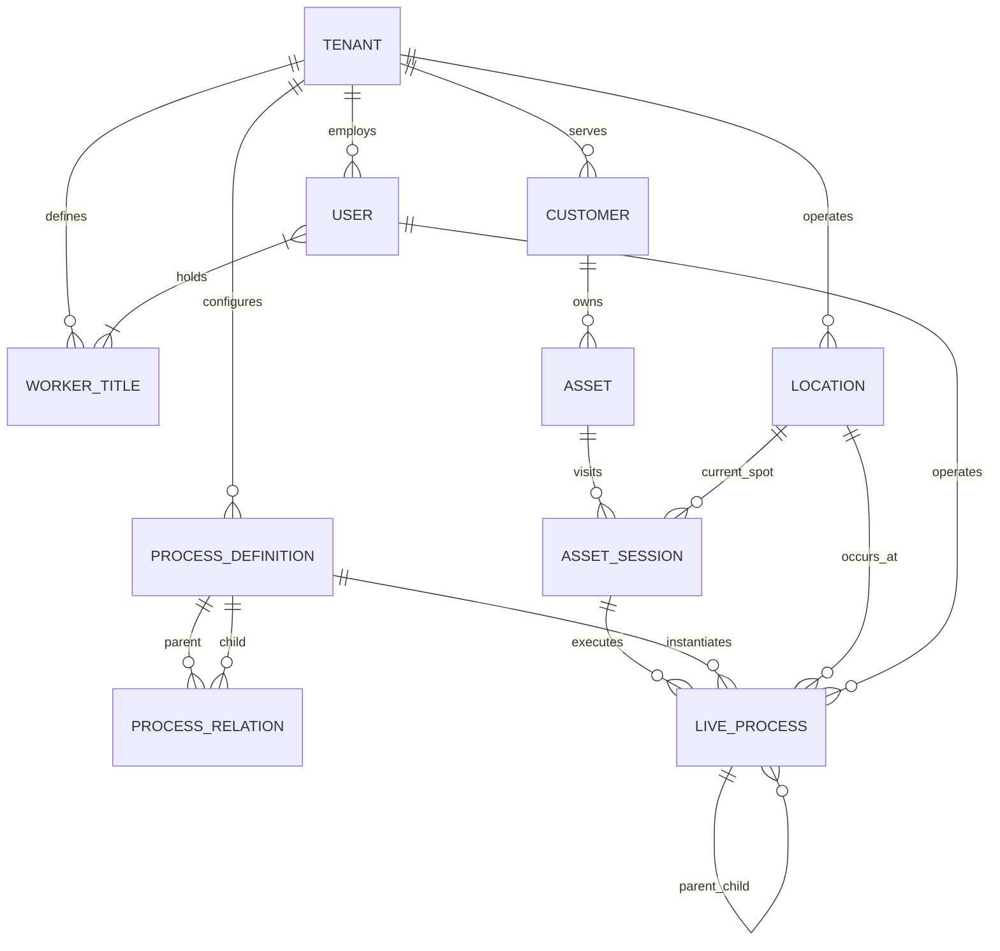

# Yonned Veri Yapıları Şartnamesi (V1.0)
**Tarih:** 27 Ekim 2026  
**Durum:** Taslak / Onaylandı  
**Mimari Felsefe:** *Generic, Loosely-Coupled (Gevşek Bağlı), İlişkisel ve Blokajsız (Non-Blocking)*

---

## 1. Mimari Vizyon ve Felsefe

Bu veri yapısı; veteriner kliniklerinden oto servis/yıkamalara, elektronik teknik servislerden özel üretim atölyelerine kadar **herhangi bir fiziksel işletmenin operasyonlarını** yönetmek üzere tasarlanmıştır.

### Temel İlkeler:
1. **Her Şey Bir Süreçtir (Everything is a Process):** Sistemde yapay "aksiyon" ve "süreç" ayrımı yoktur. Süresi olan işler (`started_at != ended_at`) ile anlık olan işler (`started_at == ended_at`, 0 saniye) aynı temel nesnedir.
2. **Gevşek Bağlılık (Loosely Coupled):** Hiçbir süreç veya adım bir personeli ya da başka bir süreci kilitlemez. Operasyonlar bağımsız yaşar, kaynaklarla (personel, lokasyon) serbestçe ilişkilendirilir.
3. **Özyinelemeli Hiyerarşi (Recursive / Tree Structure):** Bir süreç içinde başka bir süreç başlayabilir, araya anlık işlemler girebilir, süreç bittiğinde peşine yeni bir süreç takılabilir.
4. **Çift Yönlü QR Mimarisi:** Hem fiziksel alanlar (istasyonlar/odalar/kafesler) hem de varlıklar (müşteri aseti) QR kodlarla fiziksel dünyada sabitlenir.

---

## 2. Temel Varlıklar (Core Entities)



---

## 3. Detaylı Veri Modeli ve Tablo Şeması

### 3.1. İşletme ve Kişiler Katmanı

#### `tenants` (İşletme)
Platformda hizmet veren her bir işletme/organizasyon.
```sql
CREATE TABLE tenants (
    id UUID PRIMARY KEY DEFAULT gen_random_uuid(),
    name VARCHAR(150) NOT NULL,
    slug VARCHAR(100) UNIQUE NOT NULL,
    settings JSONB DEFAULT '{}', -- Logo, çalışma saatleri, bildirim ayarları
    created_at TIMESTAMP WITH TIME ZONE DEFAULT NOW()
);
```

#### `worker_titles` (İşletme Unvanları / Mesleki Tipler)
Patronun kendi sektörüne göre serbestçe tanımladığı unvanlar (Örn: Doktor, Hemşire, Kuaför, Usta, Çırak, Danışman).
```sql
CREATE TABLE worker_titles (
    id UUID PRIMARY KEY DEFAULT gen_random_uuid(),
    tenant_id UUID NOT NULL REFERENCES tenants(id) ON DELETE CASCADE,
    title_name VARCHAR(100) NOT NULL, -- "Veteriner Hekim", "Detailing Ustası", "Teknisyen"
    created_at TIMESTAMP WITH TIME ZONE DEFAULT NOW()
);
```

#### `users` (Personel ve Yöneticiler)
Sisteme giriş yapan gerçek kişiler.
```sql
CREATE TABLE users (
    id UUID PRIMARY KEY DEFAULT gen_random_uuid(),
    tenant_id UUID NOT NULL REFERENCES tenants(id) ON DELETE CASCADE,
    name VARCHAR(100) NOT NULL,
    email VARCHAR(150) NOT NULL UNIQUE,
    phone VARCHAR(50),
    
    -- Sistemsel Yetki Rolü:
    system_role VARCHAR(50) NOT NULL DEFAULT 'operator', 
    -- 'owner' (patron), 'admin' (yönetici), 'operator' (çalışan), 'viewer' (sadece izleyici)
    
    is_active BOOLEAN DEFAULT TRUE,
    created_at TIMESTAMP WITH TIME ZONE DEFAULT NOW()
);
```

#### `user_title_assignments` (Kişi-Unvan Çoktan-Çoğa Eşleşmesi)
Bir çalışan birden fazla işletme unvanına sahip olabilir (Tam esneklik).
```sql
CREATE TABLE user_title_assignments (
    user_id UUID REFERENCES users(id) ON DELETE CASCADE,
    title_id UUID REFERENCES worker_titles(id) ON DELETE CASCADE,
    PRIMARY KEY (user_id, title_id)
);
```

---

### 3.2. Fiziksel Mekanlar ve QR Kodlar

#### `locations` (İstasyonlar / Odalar / Alanlar)
İşletmenin fiziksel koordinatları. Her lokasyonun duvara, masaya veya kafese yapıştırılan sabit bir QR kodu vardır.
```sql
CREATE TABLE locations (
    id UUID PRIMARY KEY DEFAULT gen_random_uuid(),
    tenant_id UUID NOT NULL REFERENCES tenants(id) ON DELETE CASCADE,
    name VARCHAR(100) NOT NULL,         -- "Kafes #1", "Ameliyathane 2", "Yıkama Peronu A", "Tezgah 3"
    location_type VARCHAR(50) NOT NULL, -- "cage", "room", "table", "bay", "shelf", "general"
    qr_code VARCHAR(100) NOT NULL UNIQUE, -- Sabit QR token (örn: loc_7a9f8b)
    capacity INTEGER DEFAULT 1,         -- Aynı anda kaç varlık barınabilir?
    metadata JSONB DEFAULT '{}',        -- Ekstra özellikler (örn: oksijen desteği var mı?)
    created_at TIMESTAMP WITH TIME ZONE DEFAULT NOW()
);
```

---

### 3.3. Müşteri ve Varlık (Asset) Katmanı

#### `customers` (Müşteri)
İşletmeye hizmet almaya gelen gerçek veya tüzel kişi.
```sql
CREATE TABLE customers (
    id UUID PRIMARY KEY DEFAULT gen_random_uuid(),
    tenant_id UUID NOT NULL REFERENCES tenants(id) ON DELETE CASCADE,
    name VARCHAR(150) NOT NULL,
    phone VARCHAR(50) NOT NULL,
    email VARCHAR(150),
    metadata JSONB DEFAULT '{}', -- Adres, vergi no, müşteri özel notu
    created_at TIMESTAMP WITH TIME ZONE DEFAULT NOW()
);
```

#### `assets` (Müşteri Varlığı / Takip Edilen Şey)
Müşteriye ait olan ve üzerinde işlem yapılan her şey (1 Müşteri $\rightarrow$ N Varlık).
```sql
CREATE TABLE assets (
    id UUID PRIMARY KEY DEFAULT gen_random_uuid(),
    tenant_id UUID NOT NULL REFERENCES tenants(id) ON DELETE CASCADE,
    customer_id UUID NOT NULL REFERENCES customers(id) ON DELETE CASCADE,
    name VARCHAR(150) NOT NULL,         -- "Tarçın", "34 ABC 123", "iPhone 15 Pro", "Elmas Kolye"
    identifier VARCHAR(100),            -- Mikroçip No, Şasi No, IMEI, Seri No
    qr_code VARCHAR(100) UNIQUE,        -- Varlığa yapıştırılan / tasmaya takılan dinamik etiket QR
    metadata JSONB DEFAULT '{}',        -- Sektörel esnek veriler (Tür, Irk, Doğum Tarihi / Model, KM)
    created_at TIMESTAMP WITH TIME ZONE DEFAULT NOW()
);
```

---

### 3.4. Süreç Şablon Kütüphanesi (Admin Tanımları)

Adminin web panelinden tanımladığı bağımsız Lego parçaları ve bunların birbirine bağlanması.

#### `process_definitions` (Süreç ve Adım Şablonları)
```sql
CREATE TABLE process_definitions (
    id UUID PRIMARY KEY DEFAULT gen_random_uuid(),
    tenant_id UUID NOT NULL REFERENCES tenants(id) ON DELETE CASCADE,
    name VARCHAR(150) NOT NULL,          -- "Genel Bakım", "Yıkama", "Tıraş", "Mama Verme", "Aşı"
    is_instant BOOLEAN DEFAULT FALSE,   -- TRUE: Anlık Olay (0 sn), FALSE: Süreli Süreç (Başla/Bitir)
    default_location_id UUID REFERENCES locations(id), -- Önerilen varsayılan lokasyon
    is_customer_visible BOOLEAN DEFAULT TRUE,          -- Müşteri takip ekranında görünsün mü?
    customer_label VARCHAR(255),         -- Müşteriye görünecek dil (örn: "Dostunuzun bakımı yapılıyor")
    icon VARCHAR(50),                    -- Mobilde görünecek ikon
    metadata_schema JSONB DEFAULT '{}',  -- Form/giriş alanları şeması (ör. kilo, ateş, parça no)
    created_at TIMESTAMP WITH TIME ZONE DEFAULT NOW()
);
```

#### `process_relations` (Şablon Kompozisyonu / İç İçe ve Sıralı Bağlama)
Süreçlerin birbirine prangalanmadan, ilişkisel olarak önerilmesini sağlayan tablo.
```sql
CREATE TABLE process_relations (
    id UUID PRIMARY KEY DEFAULT gen_random_uuid(),
    parent_definition_id UUID NOT NULL REFERENCES process_definitions(id) ON DELETE CASCADE,
    child_definition_id UUID NOT NULL REFERENCES process_definitions(id) ON DELETE CASCADE,
    sort_order INTEGER DEFAULT 0,        -- Varsayılan sıra önerisi
    is_optional BOOLEAN DEFAULT TRUE     -- Çalışan bu adımı atlayabilir mi?
);
```

---

### 3.5. Canlı İşleyiş Katmanı (Runtime Execution)

#### `asset_sessions` (Varlığın İşletmedeki Yaşam Döngüsü / Ziyaret)
Varlığın kapıdan girdiği an başlayan, teslim edilene kadar açık kalan en üst çatı.
```sql
CREATE TABLE asset_sessions (
    id UUID PRIMARY KEY DEFAULT gen_random_uuid(),
    tenant_id UUID NOT NULL REFERENCES tenants(id) ON DELETE CASCADE,
    asset_id UUID NOT NULL REFERENCES assets(id) ON DELETE CASCADE,
    customer_id UUID NOT NULL REFERENCES customers(id) ON DELETE CASCADE,
    
    status VARCHAR(50) NOT NULL DEFAULT 'open', 
    -- 'open' (dükkanda işlem görüyor), 'ready_for_pickup' (bitti, teslim bekliyor), 'closed' (teslim edildi)
    
    current_location_id UUID REFERENCES locations(id), -- Şu an fiziki olarak hangi istasyonda/kafeste?
    
    tracking_token VARCHAR(100) NOT NULL UNIQUE,       -- Müşteri canlı takip linki token'ı
    
    check_in_at TIMESTAMP WITH TIME ZONE DEFAULT NOW(),
    check_out_at TIMESTAMP WITH TIME ZONE              -- Teslim edilince dolar
);
```

#### `live_processes` (Canlı Süreç Ağacı - Başlayan, Biten, Araya Giren İşler)
İster 2 günlük yatış, ister 40 dakikalık tıraş, ister 1 saniyelik mama verme, ister araya giren acil dikiş müdahalesi... Hepsi bu tablodaki bir düğümdür (`Node`).
```sql
CREATE TABLE live_processes (
    id UUID PRIMARY KEY DEFAULT gen_random_uuid(),
    session_id UUID NOT NULL REFERENCES asset_sessions(id) ON DELETE CASCADE,
    definition_id UUID REFERENCES process_definitions(id), -- Hangi şablondan türedi? (Serbest ise NULL)
    
    -- Özyinelemeli İlişkiler:
    parent_id UUID REFERENCES live_processes(id) ON DELETE CASCADE, -- İç içe süreçler için
    previous_id UUID REFERENCES live_processes(id),                 -- Sıralı akış zinciri için
    
    name VARCHAR(150) NOT NULL,          -- "Tıraş", "Pansuman", "Mama Verildi"
    status VARCHAR(50) NOT NULL,         -- 'queued', 'running', 'paused', 'completed', 'cancelled'
    
    -- Fiziksel Mekan:
    location_id UUID REFERENCES locations(id), -- O an nerede yapıldı/yapılıyor?
    
    -- Operatör / Çalışan (Kilitleyici değil, ilişkisel):
    assigned_operator_id UUID REFERENCES users(id), -- Süreci üzerine alan / atanan
    completed_by_id UUID REFERENCES users(id),      -- Süreci tamamlayan / kapatan
    
    -- Zaman Çizelgesi:
    started_at TIMESTAMP WITH TIME ZONE DEFAULT NOW(),
    ended_at TIMESTAMP WITH TIME ZONE,              -- Anlık işlemlerde started_at ile aynıdır
    duration_seconds INTEGER,                       -- Otomatik hesaplanan süre
    
    -- Müşteri İletişimi:
    is_customer_visible BOOLEAN DEFAULT TRUE,
    customer_notes VARCHAR(255),
    
    -- Kanıt & Ekstra Veriler:
    notes TEXT,
    photos JSONB DEFAULT '[]',           -- ["https://s3.../photo1.jpg"]
    metadata JSONB DEFAULT '{}'          -- Ateş, kilo, kullanılan malzeme vb.
);
```

#### `live_process_operators` (Çoklu Operatör Katılımı)
Bir ameliyatta veya oto yıkamada birden fazla çalışan aynı süreç üzerinde eşzamanlı çalışabilir.
```sql
CREATE TABLE live_process_operators (
    id UUID PRIMARY KEY DEFAULT gen_random_uuid(),
    process_id UUID NOT NULL REFERENCES live_processes(id) ON DELETE CASCADE,
    user_id UUID NOT NULL REFERENCES users(id) ON DELETE CASCADE,
    role VARCHAR(50) DEFAULT 'operator', -- 'lead', 'assistant', 'collaborator'
    joined_at TIMESTAMP WITH TIME ZONE DEFAULT NOW()
);
```

### 3.6. Sarf Malzeme, İlaç ve Parça Tüketimi Katmanı

İşlemler sırasında kullanılan ilaç, serum, şampuan, yedek parça, motor yağı vb. sarf malzemelerin sürece ilişkilendirilmesi.

#### `consumable_items` (Malzeme / İlaç / Parça Kataloğu)
İşletmenin kullandığı sarf ürünler. Önceden admin panelden girilebilir veya sahada çalışan tarafından barkod okutulduğu an hızlıca kaydedilebilir.
```sql
CREATE TABLE consumable_items (
    id UUID PRIMARY KEY DEFAULT gen_random_uuid(),
    tenant_id UUID NOT NULL REFERENCES tenants(id) ON DELETE CASCADE,
    name VARCHAR(150) NOT NULL,          -- "Amoklavin 500mg", "Castrol 5W-30", "Kene Damlası", "iPhone 13 Ekran"
    barcode VARCHAR(100) UNIQUE,         -- İlacın/kutunun orijinal GTIN/EAN barkodu
    unit VARCHAR(20) DEFAULT 'adet',     -- 'adet', 'ml', 'kutu', 'litre', 'doz'
    metadata JSONB DEFAULT '{}',         -- Dozaj, üretici, kritik stok seviyesi
    created_at TIMESTAMP WITH TIME ZONE DEFAULT NOW()
);
```

#### `process_consumables` (Süreçte Kullanılan Sarf Malzemeler)
Hangi süreçte hangi ilaç/parça ne kadar kullanıldı? Hiçbir süreci kilitlemez; opsiyoneldir.
```sql
CREATE TABLE process_consumables (
    id UUID PRIMARY KEY DEFAULT gen_random_uuid(),
    process_id UUID NOT NULL REFERENCES live_processes(id) ON DELETE CASCADE,
    item_id UUID REFERENCES consumable_items(id), -- Katalogdaki ürün (varsa)
    custom_name VARCHAR(150),                     -- Katalogda yoksa o an serbestçe yazılan ad
    barcode_scanned VARCHAR(100),                 -- Okutulan fiziksel barkod
    quantity NUMERIC(10, 2) DEFAULT 1,            -- Miktar (ör: 2.5 ml, 1 adet, 4 litre)
    administered_by_id UUID REFERENCES users(id), -- Hangi çalışan kullandı/enjekte etti?
    notes TEXT,                                   -- "Sağ koldan uygulandı"
    created_at TIMESTAMP WITH TIME ZONE DEFAULT NOW()
);
```

---

## 4. Evrensel Tarayıcı (Universal Scanner) ve Sıfır Blokajlı İşleyiş

Sahada çalışan personelin (eldivenli hekim, yağlı usta) ekranda uzun aramalar yapmasını engellemek için **tek bir kamera vizörü** ile tüm fiziksel nesneler taranır ve çözümlenir:

```
                      ┌─── [1. 'loc_' ile başlıyorsa] ──► FİZİKSEL MEKAN (Kafes/Masa/Peron)
                      │                                    ➔ İstasyon kartını aç / transfer et
                      │
                      ├─── [2. 'ast_' ile başlıyorsa] ──► MÜŞTERİ VARLIĞI (Hasta/Araç/Cihaz)
[KAMERA VİZÖRÜ] ──────┼                                    ➔ Canlı ziyaret kartını aç
                      │
                      ├─── [3. Sistemde Kayıtlı Barkod] ─► SARF MALZEME (İlaç / Parça)
                      │                                    ➔ Açık olan sürece anında iliştir!
                      │
                      └─── [4. Sistemde Tanımsız Barkod] ─► ANINDA EKLE (On-The-Fly / JIT)
                                                           ➔ "Ürün Adı:" yaz ➔ Kaydet!
                                                           ➔ Hem kataloğa eklenir hem sürece bağlanır.
```

### Sıfır Blokaj (Non-Blocking) Garantisi:
1. **Kamera Şart Değildir:** Barkod silikse, kamera yoksa veya bozulursa çalışan **listeden arama / filtreleme** ile her varlığı, mekanı veya ilacı seçebilir.
2. **Katalogda Olmama Hatası Yoktur:** Okutulan bir ilaç veya parça sistemde tanımlı değilse sistem hata verip durdurmaz; hemen orada adını girip sürece bağlamaya izin verir.
3. **Rol Kilidi Yoktur:** Bir işlemi başlatmak veya ilacı kaydetmek için belirli bir çalışana yapışık olmak gerekmez; o an işlemi yapan kimse onun imzasıyla kaydedilir.

---

## 5. Stres Testi Senaryoları ile Doğrulama

### Senaryo 1: Standart Akış
1. Kedi "Tarçın" kliniğe girer $\rightarrow$ `asset_sessions` açılır.
2. `live_processes` içine "Genel Bakım" (running) eklenir.
3. İçine alt süreç "Yıkama" eklenir $\rightarrow$ Biter.
4. İçine alt süreç "Tıraş" eklenir $\rightarrow$ Biter.
5. "Genel Bakım" biter.
6. Tarçın Kafes #2'ye alınır (`current_location_id = Kafes 2`, `session.status = ready_for_pickup`).
7. Müşteri gelir, teslim edilir $\rightarrow$ `session.status = closed`.

### Senaryo 2: Beklenmedik Olay / Acil Müdahale ve İlaç Kullanımı
1. Tıraş devam ederken kaza gerçekleşir (kesik oluşur).
2. Kuaför veya hekim Tarçın'ın ekranında tek tıkla `[+ Acil Müdahale]` sürecini açar (`parent_id: Genel Bakım` veya bağımsız).
3. Hekim dolaptan aldığı antibiyotiğin barkodunu kameraya tutar:
   * İlaç daha önce sisteme girilmediyse: Ekranda *"Yeni İlaç: Adı girin"* der $\rightarrow$ *"Sprey Antibiyotik"* yazar.
   * `process_consumables` tablosuna anında 1 doz eklenir.
4. Dikiş atılır, fotoğraf yüklenir, müdahale `status: completed` yapılır.
5. Tıraş sürecine dönülür ve işlem tamamlanır.
6. **Sonuç:** Hiçbir aşamada sistem çalışanı engellememiştir; hem kaza müdahalesi hem kullanılan ilaç tek bir akışta kusursuzca arşivlenmiştir.

