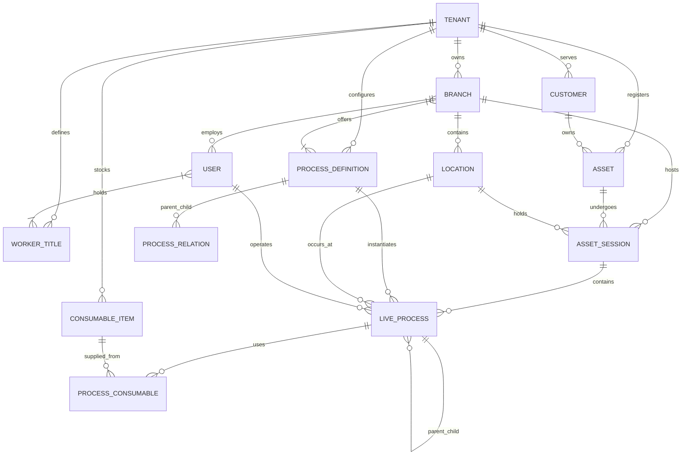

# Yonned Veri Yapıları Şartnamesi (V1.0)
**Tarih:** 27 Ekim 2026  
**Durum:** Onaylandı / Genişletildi  
**Mimari Felsefe:** *Generic, Loosely-Coupled (Gevşek Bağlı), Çoklu Bayi (Multi-Branch), Varlık Dolaşımı (Asset Roaming), Sıfır-Tekrar (Zero-Duplication) ve Sıfır-Blokaj (Non-Blocking)*

---

## 1. Mimari Vizyon ve Temel İlkeler

Bu sistem; tek şubeli butik bir klinikten onlarca bayisi olan zincir oto servis/detailing ağlarına kadar **herhangi bir fiziksel işletmenin operasyonlarını** merkezi olarak yönetmek üzere tasarlanmıştır.

### Temel Prensipler:
1. **Her Şey Bir Süreçtir (Unified Process):** "Aksiyon" ve "Süreç" ayrımı yoktur. Süresi olan işler (`started_at != ended_at`) ile anlık olan işler (`started_at == ended_at`, 0 saniye) aynı temel nesnedir.
2. **Sıfır Tekrar ile Varlık Dolaşımı (Asset Roaming):** Müşteri ve varlık kayıtları üst çatı şirkete (Tenant) aittir. Bir varlık Kadıköy şubesinden Beşiktaş veya Bodrum bayisine gittiğinde yeniden oluşturulmaz; tüm servis ve müdahale geçmişiyle birlikte özgürce bayiler arasında dolaşır.
3. **Birleşik Varlık Modeli (Customer & Business Assets):** Sistem sadece müşterinin getirdiği varlıkları değil (kedi, araba, telefon); işletmenin kendi demirbaşlarını da (ultrason cihazı, ikame araç, arıza tespit kiti) aynı varlık yapısıyla yönetir ve bayiler arasında transfer edebilir.
4. **Gevşek Bağlılık ve Sıfır Blokaj (Zero Blocking):** Hiçbir kural çalışanı sahada kilitlemez. Süreçler personele tapulu değildir (havuzdan alınabilir, devredilebilir); barkodu olmayan bir ilaç veya parça anında orada adlandırılarak sürece bağlanabilir.
5. **Özyinelemeli Ağaç Mimarisi (Recursive Execution):** Süreçler iç içe girebilir, araya anlık işlemler alabilir veya sıralı zincirler oluşturabilir.
6. **Evrensel Tarayıcı (Universal Scanner):** Tek bir kamera vizörüyle mekan QR'ı, varlık QR'ı, müşteri fişi veya ilaç/parça barkodu taranır ve otomatik çözümlenir.

---

## 2. Standart Sistem Tipleri (Core System Enums)

Sistemin motorunu standartlaştıran ve kod seviyesinde güvenliği sağlayan çekirdek tipler:

| Sistem Tipi | Değerler | Açıklama |
| :--- | :--- | :--- |
| **`SystemRole`** | `superadmin`, `tenant_owner`, `branch_manager`, `operator`, `viewer` | Kullanıcının sistem üzerindeki yetki sınırları. |
| **`SessionStatus`** | `checked_in`, `in_service`, `ready_for_pickup`, `completed`, `cancelled` | Varlığın dükkandaki ana kabul/ziyaret evreleri. |
| **`ProcessStatus`** | `queued`, `running`, `paused`, `completed`, `cancelled` | Canlı bir sürecin o anki çalışma durumu. |
| **`ProcessKind`** | `durational`, `instant` | Süreli (başla/bitir) mi yoksa anlık (0 sn) mi? |
| **`LocationKind`** | `holding`, `workbench`, `room`, `general` | Barınma/kafes mi, çalışma tezgahı mı, oda mı? |
| **`AssetOwnerType`**| `customer`, `business` | Müşteri varlığı mı yoksa işletme demirbaşı mı? |
| **`ScanTargetType`** | `location_qr`, `asset_qr`, `session_qr`, `consumable_barcode` | Kameranın okuduğu nesnenin çözümlenen tipi. |

*(Not: Doktor, Usta, Hemşire gibi mesleki roller sistem tipi değil; adminin serbestçe tanımladığı `worker_titles`dır).*

---

## 3. Temel Varlıklar ve ER Diyagramı



---

## 4. Detaylı Veri Modeli ve Tablo Şeması (PostgreSQL DDL)

### 4.1. İşletme ve Bayi (Şube) Katmanı

#### `tenants` (Çatı Şirket / Organizasyon)
```sql
CREATE TABLE tenants (
    id UUID PRIMARY KEY DEFAULT gen_random_uuid(),
    name VARCHAR(150) NOT NULL,
    slug VARCHAR(100) UNIQUE NOT NULL,
    settings JSONB DEFAULT '{}', -- Logo, global renkler, fatura bilgileri
    created_at TIMESTAMP WITH TIME ZONE DEFAULT NOW()
);
```

#### `branches` (Bayiler / Şubeler)
İşletmeye bağlı fiziksel şubeler (Kadıköy, Beşiktaş, Bodrum vb.).
```sql
CREATE TABLE branches (
    id UUID PRIMARY KEY DEFAULT gen_random_uuid(),
    tenant_id UUID NOT NULL REFERENCES tenants(id) ON DELETE CASCADE,
    name VARCHAR(150) NOT NULL,          -- "Kadıköy Merkez Şube", "Beşiktaş Bayi"
    code VARCHAR(50),                    -- "KDK-01", "BJK-02"
    address TEXT,
    phone VARCHAR(50),
    is_active BOOLEAN DEFAULT TRUE,
    metadata JSONB DEFAULT '{}',         -- Bayi özel çalışma saatleri, konum koordinatları
    created_at TIMESTAMP WITH TIME ZONE DEFAULT NOW()
);
```

---

### 4.2. Kişiler, Yetkiler ve Unvanlar Katmanı

#### `worker_titles` (İşletme Unvanları - Dinamik Roller)
Adminin kendi sektörüne göre serbestçe girdiği mesleki unvanlar.
```sql
CREATE TABLE worker_titles (
    id UUID PRIMARY KEY DEFAULT gen_random_uuid(),
    tenant_id UUID NOT NULL REFERENCES tenants(id) ON DELETE CASCADE,
    title_name VARCHAR(100) NOT NULL, -- "Başhekim", "Anestezi Teknikeri", "Detailing Ustası"
    created_at TIMESTAMP WITH TIME ZONE DEFAULT NOW()
);
```

#### `users` (Personel ve Yöneticiler)
```sql
CREATE TABLE users (
    id UUID PRIMARY KEY DEFAULT gen_random_uuid(),
    tenant_id UUID NOT NULL REFERENCES tenants(id) ON DELETE CASCADE,
    default_branch_id UUID REFERENCES branches(id), -- Personelin ana bağlı olduğu şube
    name VARCHAR(100) NOT NULL,
    email VARCHAR(150) NOT NULL UNIQUE,
    phone VARCHAR(50),
    
    -- Standart Sistem Rolü:
    system_role VARCHAR(50) NOT NULL DEFAULT 'operator', 
    -- 'superadmin', 'tenant_owner', 'branch_manager', 'operator', 'viewer'
    
    is_active BOOLEAN DEFAULT TRUE,
    created_at TIMESTAMP WITH TIME ZONE DEFAULT NOW()
);
```

#### `user_title_assignments` (Kişi-Unvan Çoktan-Çoğa Eşleşmesi)
Bir çalışan birden fazla işletme unvanına sahip olabilir (Doktor + Cerrahi Uzmanı gibi).
```sql
CREATE TABLE user_title_assignments (
    user_id UUID REFERENCES users(id) ON DELETE CASCADE,
    title_id UUID REFERENCES worker_titles(id) ON DELETE CASCADE,
    PRIMARY KEY (user_id, title_id)
);
```

---

### 4.3. Fiziksel Mekanlar ve QR Kodlar

#### `locations` (İstasyonlar / Odalar / Kafesler)
Fiziksel alanlar doğrudan bir **şubeye** aittir ve üzerlerinde sabit QR kodları taşırlar.
```sql
CREATE TABLE locations (
    id UUID PRIMARY KEY DEFAULT gen_random_uuid(),
    tenant_id UUID NOT NULL REFERENCES tenants(id) ON DELETE CASCADE,
    branch_id UUID NOT NULL REFERENCES branches(id) ON DELETE CASCADE, -- Hangi bayide?
    name VARCHAR(100) NOT NULL,         -- "Kafes #1", "Ameliyathane 2", "Yıkama Peronu A"
    location_kind VARCHAR(50) NOT NULL DEFAULT 'holding', -- 'holding', 'workbench', 'room', 'general'
    qr_code VARCHAR(100) NOT NULL UNIQUE, -- Sabit QR token (örn: loc_kdk_01)
    capacity INTEGER DEFAULT 1,         -- Aynı anda kaç varlık barınabilir?
    metadata JSONB DEFAULT '{}',        -- Ekstra özellikler (lift tonajı, oksijen desteği vb.)
    created_at TIMESTAMP WITH TIME ZONE DEFAULT NOW()
);
```

---

### 4.4. Müşteri ve Birleşik Varlık (Asset) Katmanı

Müşteriler ve Varlıklar çatı işletmeye (Tenant) bağlıdır; bayiler arasında özgürce gezer (Roaming).

#### `customers` (Müşteri - Tekil)
```sql
CREATE TABLE customers (
    id UUID PRIMARY KEY DEFAULT gen_random_uuid(),
    tenant_id UUID NOT NULL REFERENCES tenants(id) ON DELETE CASCADE,
    name VARCHAR(150) NOT NULL,
    phone VARCHAR(50) NOT NULL,
    email VARCHAR(150),
    metadata JSONB DEFAULT '{}',
    created_at TIMESTAMP WITH TIME ZONE DEFAULT NOW()
);
```

#### `assets` (Birleşik Varlık - Müşteri Aseti veya İşletme Demirbaşı)
```sql
CREATE TABLE assets (
    id UUID PRIMARY KEY DEFAULT gen_random_uuid(),
    tenant_id UUID NOT NULL REFERENCES tenants(id) ON DELETE CASCADE,
    
    -- Varlık Tipi:
    owner_type VARCHAR(20) NOT NULL DEFAULT 'customer', -- 'customer' VEYA 'business'
    
    -- Müşteri Varlığı ise (Zorunlu):
    customer_id UUID REFERENCES customers(id) ON DELETE CASCADE, 
    
    -- İşletme Demirbaşı ise (Örn: Taşınabilir Ultrason, İkame Araç, Arıza Cihazı):
    current_branch_id UUID REFERENCES branches(id), -- Demirbaş şu an hangi bayide?
    
    name VARCHAR(150) NOT NULL,         -- "Tarçın", "34 ABC 123", "Taşınabilir Ultrason Cihazı"
    identifier VARCHAR(100),            -- Çip No, Şasi No, IMEI, Seri No
    qr_code VARCHAR(100) UNIQUE,        -- Varlığa takılan/yapıştırılan etiket QR
    metadata JSONB DEFAULT '{}',        -- Tür, Irk, Yaş / Marka, Model, KM
    created_at TIMESTAMP WITH TIME ZONE DEFAULT NOW()
);
```

---

### 4.5. Süreç Şablon Kütüphanesi ve Bayi Uyarlaması

#### `process_definitions` (Lego Şablonları)
```sql
CREATE TABLE process_definitions (
    id UUID PRIMARY KEY DEFAULT gen_random_uuid(),
    tenant_id UUID NOT NULL REFERENCES tenants(id) ON DELETE CASCADE,
    name VARCHAR(150) NOT NULL,          -- "Genel Bakım", "Yıkama", "Tıraş", "Mama Verme"
    is_instant BOOLEAN DEFAULT FALSE,   -- TRUE: Anlık Olay (0 sn), FALSE: Süreli Süreç
    default_location_id UUID REFERENCES locations(id),
    is_customer_visible BOOLEAN DEFAULT TRUE,
    customer_label VARCHAR(255),         -- Müşteriye görünecek bildirim dili
    icon VARCHAR(50),
    metadata_schema JSONB DEFAULT '{}',  -- Form/giriş alanları (kilo, ateş, parça no)
    created_at TIMESTAMP WITH TIME ZONE DEFAULT NOW()
);
```

#### `process_relations` (Şablon Kompozisyonu)
Süreçlerin birbirine prangalanmadan, ilişkisel olarak önerilmesini sağlayan tablo.
```sql
CREATE TABLE process_relations (
    id UUID PRIMARY KEY DEFAULT gen_random_uuid(),
    parent_definition_id UUID NOT NULL REFERENCES process_definitions(id) ON DELETE CASCADE,
    child_definition_id UUID NOT NULL REFERENCES process_definitions(id) ON DELETE CASCADE,
    sort_order INTEGER DEFAULT 0,
    is_optional BOOLEAN DEFAULT TRUE
);
```

#### `process_branch_availability` (Süreç $\leftrightarrow$ Bayi İlişkisi)
Hangi süreç hangi bayide mevcut? *(Tabloda kayıt yoksa: Süreç TÜM bayilerde geçerlidir).*
```sql
CREATE TABLE process_branch_availability (
    process_definition_id UUID NOT NULL REFERENCES process_definitions(id) ON DELETE CASCADE,
    branch_id UUID NOT NULL REFERENCES branches(id) ON DELETE CASCADE,
    PRIMARY KEY (process_definition_id, branch_id)
);
```

---

### 4.6. Sarf Malzeme, İlaç ve Parça Tüketimi Katmanı

#### `consumable_items` (Malzeme / İlaç / Parça Kataloğu)
```sql
CREATE TABLE consumable_items (
    id UUID PRIMARY KEY DEFAULT gen_random_uuid(),
    tenant_id UUID NOT NULL REFERENCES tenants(id) ON DELETE CASCADE,
    name VARCHAR(150) NOT NULL,          -- "Amoklavin 500mg", "Castrol 5W-30", "iPhone 13 Ekran"
    barcode VARCHAR(100) UNIQUE,         -- İlacın/kutunun orijinal GTIN/EAN barkodu
    unit VARCHAR(20) DEFAULT 'adet',     -- 'adet', 'ml', 'kutu', 'litre', 'doz'
    metadata JSONB DEFAULT '{}',
    created_at TIMESTAMP WITH TIME ZONE DEFAULT NOW()
);
```

#### `process_consumables` (Süreçte Kullanılan Sarf Malzemeler)
```sql
CREATE TABLE process_consumables (
    id UUID PRIMARY KEY DEFAULT gen_random_uuid(),
    process_id UUID NOT NULL REFERENCES live_processes(id) ON DELETE CASCADE,
    item_id UUID REFERENCES consumable_items(id),
    custom_name VARCHAR(150),                     -- Katalogda yoksa o an yazılan ad
    barcode_scanned VARCHAR(100),
    quantity NUMERIC(10, 2) DEFAULT 1,
    administered_by_id UUID REFERENCES users(id),
    notes TEXT,
    created_at TIMESTAMP WITH TIME ZONE DEFAULT NOW()
);
```

---

### 4.7. Canlı Operasyon ve Yaşam Döngüsü (Runtime Execution)

#### `asset_sessions` (Varlığın Bayideki Ziyaret Oturumu)
Varlığın belirli bir bayiye girdiği an başlayan ve çıkana kadar açık kalan en üst çatı.
```sql
CREATE TABLE asset_sessions (
    id UUID PRIMARY KEY DEFAULT gen_random_uuid(),
    tenant_id UUID NOT NULL REFERENCES tenants(id) ON DELETE CASCADE,
    branch_id UUID NOT NULL REFERENCES branches(id) ON DELETE CASCADE, -- Hangi bayide misafir?
    asset_id UUID NOT NULL REFERENCES assets(id) ON DELETE CASCADE,
    customer_id UUID REFERENCES customers(id) ON DELETE CASCADE,      -- Müşteri aseti ise
    
    status VARCHAR(50) NOT NULL DEFAULT 'checked_in', 
    -- 'checked_in', 'in_service', 'ready_for_pickup', 'completed', 'cancelled'
    
    current_location_id UUID REFERENCES locations(id), -- Şu an hangi kafeste/peronda?
    tracking_token VARCHAR(100) NOT NULL UNIQUE,       -- Müşteri canlı takip linki
    
    check_in_at TIMESTAMP WITH TIME ZONE DEFAULT NOW(),
    check_out_at TIMESTAMP WITH TIME ZONE
);
```

#### `live_processes` (Canlı Süreç Ağacı)
İster 2 günlük yatış, ister 40 dakikalık tıraş, ister anlık mama verme veya beklenmedik acil dikiş müdahalesi...
```sql
CREATE TABLE live_processes (
    id UUID PRIMARY KEY DEFAULT gen_random_uuid(),
    session_id UUID NOT NULL REFERENCES asset_sessions(id) ON DELETE CASCADE,
    definition_id UUID REFERENCES process_definitions(id),
    
    -- Özyinelemeli İlişkiler (Ağaç):
    parent_id UUID REFERENCES live_processes(id) ON DELETE CASCADE,
    previous_id UUID REFERENCES live_processes(id),
    
    name VARCHAR(150) NOT NULL,
    status VARCHAR(50) NOT NULL DEFAULT 'queued', -- 'queued', 'running', 'paused', 'completed', 'cancelled'
    
    -- İlişkili Kaynaklar (Blokajsız):
    location_id UUID REFERENCES locations(id),
    assigned_operator_id UUID REFERENCES users(id),
    completed_by_id UUID REFERENCES users(id),
    
    -- Zaman Çizelgesi:
    started_at TIMESTAMP WITH TIME ZONE DEFAULT NOW(),
    ended_at TIMESTAMP WITH TIME ZONE,
    duration_seconds INTEGER,
    
    -- Müşteri İletişimi:
    is_customer_visible BOOLEAN DEFAULT TRUE,
    customer_notes VARCHAR(255),
    
    -- Kanıt & Ekstra Veriler:
    notes TEXT,
    photos JSONB DEFAULT '[]',
    metadata JSONB DEFAULT '{}'
);
```

#### `live_process_operators` (Çoklu Operatör Katılımı)
```sql
CREATE TABLE live_process_operators (
    id UUID PRIMARY KEY DEFAULT gen_random_uuid(),
    process_id UUID NOT NULL REFERENCES live_processes(id) ON DELETE CASCADE,
    user_id UUID NOT NULL REFERENCES users(id) ON DELETE CASCADE,
    role VARCHAR(50) DEFAULT 'operator', -- 'lead', 'assistant', 'collaborator'
    joined_at TIMESTAMP WITH TIME ZONE DEFAULT NOW()
);
```

---

## 5. Evrensel Tarayıcı (Universal Scanner) ve Sıfır Blokaj

Sahadaki personelin ekranda kaybolmasını engellemek için **tek bir kamera vizörü** tüm fiziksel nesneleri anında tanır:

```
                      ┌─── [1. 'loc_' ile başlıyorsa] ──► FİZİKSEL MEKAN (Kafes/Masa/Peron)
                      │                                    ➔ İstasyon kartını aç / varlığı transfer et
                      │
                      ├─── [2. 'ast_' ile başlıyorsa] ──► VARLIK (Müşteri Aseti veya İşletme Demirbaşı)
[KAMERA VİZÖRÜ] ──────┼                                    ➔ Canlı ziyaret kartını aç / detayını gör
                      │
                      ├─── [3. 'ses_' ile başlıyorsa] ──► BİLET / ZİYARET TAKİBİ
                      │                                    ➔ Doğrudan aktif oturumu aç
                      │
                      ├─── [4. Sistemde Kayıtlı Barkod] ─► SARF MALZEME (İlaç / Parça / Şampuan)
                      │                                    ➔ Açık olan sürece anında iliştir!
                      │
                      └─── [5. Tanımsız / Yeni Barkod] ──► ANINDA EKLE (On-The-Fly / JIT)
                                                           ➔ "Ürün Adı:" yaz ➔ Kaydet!
                                                           ➔ Hem kataloğa eklenir hem sürece bağlanır.
```

### Sıfır Blokaj Garantileri:
1. **Kamera Şart Değildir:** Kamera yoksa çalışan her zaman **arama kutusundan** veya listeden seçim yapabilir.
2. **Katalogda Olmama Hatası Yoktur:** Sistem "Kayıtlı ürün yok" deyip durdurmaz; anında adını girip kullanmaya izin verir.
3. **Rol Kilidi Yoktur:** Süreci herhangi bir yetkili çalışan başlatabilir, başka bir çalışan devralıp bitirebilir.

---

## 6. Doğrulama Senaryoları (Stres Testleri)

### Senaryo 1: Bayiler Arası Varlık Dolaşımı (Asset Roaming)
1. Kedi "Tarçın" Kadıköy Şubesine gelir $\rightarrow$ `branch_id: Kadıköy` ile ziyaret açılır, aşıları yapılır ve tamamlanır.
2. 3 ay sonra sahibi Tarçın'ı Beşiktaş Şubesine getirir.
3. Beşiktaş çalışanı Tarçın'ın QR'ını okutur $\rightarrow$ Sistem anında Tarçın'ın tüm geçmişini ve Kadıköy'deki aşılarını gösterir.
4. Yeni bir ziyaret açılır (`branch_id: Beşiktaş`).
5. **Sonuç:** Mükerrer müşteri veya kedi kaydı AÇILMAZ. Bilgi kaybı yaşanmaz.

### Senaryo 2: Beklenmedik Kaza ve Anında İlaç Barkodu Okutma
1. Tıraş devam ederken makine kesik yapar.
2. Kuaför Tarçın'ın kartında `[+ Acil Müdahale]` sürecini başlatır (`operator: Dr. Mehmet`).
3. Dr. Mehmet ecza dolabından aldığı spreyin barkodunu kameraya tutar $\rightarrow$ Barkod sistemde yoksa bile ekranda *"Yeni İlaç Adı:"* çıkar, *"Yara Spreyi"* yazar ve kaydeder.
4. Dikiş tamamlanır, fotoğraf çekilir, süreç kapanır.
5. Kuaför tıraş sürecine dönüp işlemi tamamlar.
6. **Sonuç:** Sistem bir saniye bile duraksamamış, hem tıbbi müdahale hem kuaförlük tek bir akışta birleşmiştir.

### Senaryo 3: İşletme Demirbaşı Kullanımı ve Transferi
1. İşletmeye ait "Taşınabilir Röntgen Cihazı" Kadıköy Şubesinde kayıtlıdır (`owner_type: business`, `current_branch_id: Kadıköy`).
2. Beşiktaş Şubesinde acil bir vaka çıkar; cihaz Beşiktaş'a transfer edilir (`current_branch_id = Beşiktaş`).
3. Cihazın periyodik bakım veya kalibrasyon süreçleri tıpkı bir canlı süreç gibi sistem üzerinden işletilir.
